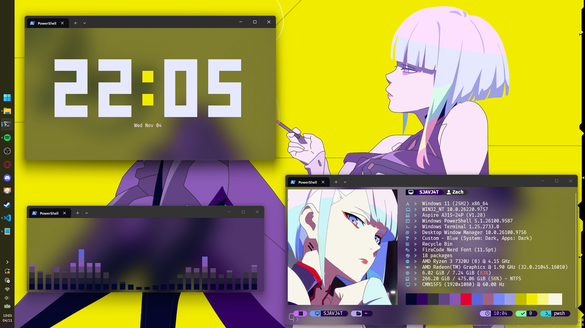

# Configuración de terminal

Configuración personal para una terminal informativa y visualmente coherente mediante **Oh My Posh**, **Fastfetch**, **Cava** y **Peaclock**. Cada componente es independiente: es posible instalar y utilizar únicamente los programas de interés.

Este repositorio contiene archivos de configuración y documentación. No automatiza la instalación de dependencias ni modifica perfiles de shell por sí mismo. Las instrucciones describen cómo copiar los archivos y cómo activar cada componente cuando corresponda.

## Tabla de contenido

- [Herramientas](#herramientas)
- [Vista previa](#vista-previa)
- [Consideraciones sobre elementos gráficos](#consideraciones-sobre-elementos-gráficos)
- [Contenido del repositorio](#contenido-del-repositorio)
- [Requisitos](#requisitos)
- [Instalación](#instalación)
  - [1. Instalación de las herramientas](#1-instalación-de-las-herramientas)
  - [2. Copia de los archivos de configuración](#2-copia-de-los-archivos-de-configuración)
  - [3. Inicialización de Oh My Posh](#3-inicialización-de-oh-my-posh)
  - [4. Configuración de Fastfetch, Cava y Peaclock](#4-configuración-de-fastfetch-cava-y-peaclock)
    - [Peaclock](#peaclock)
  - [5. Ejecución automática al abrir la terminal](#5-ejecución-automática-al-abrir-la-terminal)
  - [6. Ejemplo integral](#6-ejemplo-integral)
  - [7. Verificación](#7-verificación)
- [Personalización](#personalización)
- [Solución de problemas](#solución-de-problemas)
- [Privacidad y publicación](#privacidad-y-publicación)
- [Recursos oficiales](#recursos-oficiales)
- [Licencia](#licencia)

## Herramientas

| Herramienta | Función | Configuración |
| --- | --- | --- |
| [Oh My Posh](https://github.com/JanDeDobbeleer/oh-my-posh) | Prompt con ruta, estado de Git, versiones de lenguajes, hora y resultado del último comando. | [`oh-my-posh/config.json`](oh-my-posh/config.json) |
| [Fastfetch](https://github.com/fastfetch-cli/fastfetch) | Resumen del sistema operativo, shell, escritorio y hardware. | [`fastfetch/config.jsonc`](fastfetch/config.jsonc) |
| [Cava](https://github.com/karlstav/cava) | Espectro de audio en la terminal con una paleta de colores configurable. | [`cava/config`](cava/config) |
| [Peaclock](https://github.com/octobanana/peaclock) | Reloj, temporizador y cronómetro interactivos para la terminal. | Ejemplo en [`peaclock/config`](peaclock/config), para copiar manualmente a `~/.peaclock/config`. |

## Vista previa



*Captura real de la configuración. «Zach» es un texto fijo del formato de Fastfetch,
no el nombre de usuario del sistema. El hostname y los datos del equipo son los
que Fastfetch detectó; revisa si alguno es un identificador que prefieras mantener
privado antes de compartir la captura.*

## Consideraciones sobre elementos gráficos

Los elementos visuales que aparecen en la terminal son el resultado de la ejecución de cada programa y no constituyen una colección de logotipos oficiales de sus respectivos proyectos.

- **Oh My Posh** compone el prompt mediante segmentos, colores y glifos. Para representar correctamente los iconos del tema se requiere una Nerd Font seleccionada en el emulador de terminal.
- **Fastfetch** usa la imagen `L2.png` de `assets/` como logo Sixel, instalada en `~/.config/fastfetch/L2.png`. Para usar otra imagen, cambia `logo.source`. Las opciones oficiales se documentan en la [guía de logos de Fastfetch](https://github.com/fastfetch-cli/fastfetch/wiki/Logo-options).
- **Cava** representa el espectro de audio mediante barras. El archivo incluido modifica su color, orientación y respuesta visual.

Las imágenes de ejemplo se encuentran en `assets/`. `Cyberpunk.png` es la captura
de vista previa y `L2.png` es la imagen usada como logo Sixel de Fastfetch. El
archivo `lucy_cyberpunk_2077_edgerunners_by_inshyi_dfdrrd6.png` contiene la
ilustración completa que aparece como fondo de escritorio en la captura; no se
instala con el script.

Los créditos y la información conocida sobre las imágenes se encuentran en
[`THIRD-PARTY-NOTICES.md`](THIRD-PARTY-NOTICES.md). La atribución no sustituye el
permiso ni la licencia necesarios para redistribuir una imagen.

## Contenido del repositorio

| Archivo | Descripción |
| --- | --- |
| [`oh-my-posh/config.json`](oh-my-posh/config.json) | Tema JSON del prompt. |
| [`oh-my-posh/config.schema.json`](oh-my-posh/config.schema.json) | Esquema local para autocompletado y validación del tema. |
| [`fastfetch/config.jsonc`](fastfetch/config.jsonc) | Módulos, formato, colores y referencia al esquema de Fastfetch. |
| [`cava/config`](cava/config) | Ajustes INI para captura, barras, degradado y suavizado. |
| [`peaclock/config`](peaclock/config) | Ejemplo opcional de comandos para Peaclock; se copia manualmente a `~/.peaclock/config`. |
| [`assets/`](assets/) | Ilustración de vista previa y logo utilizado por Fastfetch. |
| [`assets/lucy_cyberpunk_2077_edgerunners_by_inshyi_dfdrrd6.png`](assets/lucy_cyberpunk_2077_edgerunners_by_inshyi_dfdrrd6.png) | Ilustración completa usada como fondo de escritorio en la captura; no se instala. |
| [`scripts/install.sh`](scripts/install.sh) | Copia las configuraciones de Oh My Posh, Fastfetch y Cava a `$XDG_CONFIG_HOME` o, si no está definida, a `~/.config` en Linux y macOS. No instala programas ni configura Peaclock ni modifica perfiles de shell. Su uso es opcional. |
| [`.vscode/settings.json`](.vscode/settings.json) | Confianza limitada a la URL del esquema utilizada por Fastfetch en VS Code. |
| [`docs/configuration-guide.md`](docs/configuration-guide.md) | Descripción de las configuraciones y sus opciones. |
| [`docs/troubleshooting.md`](docs/troubleshooting.md) | Diagnóstico de problemas de fuentes, esquemas, imágenes, audio y Peaclock. |
| [`CONTRIBUTING.md`](CONTRIBUTING.md) | Reglas para proponer cambios y proteger datos personales y licencias. |
| [`THIRD-PARTY-NOTICES.md`](THIRD-PARTY-NOTICES.md) | Atribución y licencia del esquema de Oh My Posh incluido. |
| [`.editorconfig`](.editorconfig) | Convenciones de formato para editores compatibles. |
| [`.gitignore`](.gitignore) | Exclusión de archivos temporales del sistema operativo y preferencias locales del editor. |
| [`LICENSE`](LICENSE) | Licencia del contenido original del repositorio. |

## Requisitos

- Instalar las herramientas desde las fuentes oficiales indicadas en [Recursos oficiales](#recursos-oficiales).
- Disponer de una **Nerd Font** instalada y seleccionada en el emulador de terminal para representar correctamente los glifos de Oh My Posh y Fastfetch. La instalación de la fuente en el sistema no implica su selección automática en la terminal.
- Fastfetch usa `assets/L2.png` como logo Sixel; las instrucciones de instalación la copian como `~/.config/fastfetch/L2.png`, que es la ruta configurada en `logo.source`. La terminal debe ser compatible con **Sixel**, como WezTerm, foot o mlterm. Puedes cambiar `logo.source` para usar otra imagen.
- El formato del título de Fastfetch usa Lua para quitar `DESKTOP-` del hostname solo cuando corresponde. Requiere Fastfetch 2.64 o posterior con soporte Lua; compruébalo con `fastfetch --list-features`.
- La captura de audio de Cava depende del sistema operativo y del servidor de sonido. En Windows se utiliza el dispositivo de salida predeterminado; en Linux puede ser necesario seleccionar el método de entrada (`pulse`, `pipewire` o `alsa`); en macOS se emplea habitualmente `portaudio`.

Los ejemplos cubren Linux, macOS y Windows. Para otros sistemas, consúltese la documentación oficial antes de reutilizar las rutas indicadas.

## Instalación

La disponibilidad de las herramientas varía según la distribución y su versión. Antes de instalar, conviene comprobar si el paquete existe y qué versión ofrece el gestor correspondiente:

```bash
apt search oh-my-posh        # Debian / Ubuntu
dnf search oh-my-posh        # Fedora
pacman -Ss oh-my-posh        # Arch Linux
zypper search oh-my-posh     # openSUSE
```

La tabla resume las opciones habituales para Cava, Fastfetch y Oh My Posh. Peaclock no está incluido en este resumen de paquetes; consulta las instrucciones de instalación y los binarios disponibles en su [repositorio oficial](https://github.com/octobanana/peaclock).

| Distribución | Cava | Fastfetch | Oh My Posh |
| --- | --- | --- | --- |
| **Enlace oficial** | [Releases de Cava](https://github.com/karlstav/cava/releases) | [Instalación de Fastfetch](https://github.com/fastfetch-cli/fastfetch#installation) | [Instalación de Oh My Posh](https://ohmyposh.dev/docs/installation) |
| **Ubuntu / Debian** | `sudo apt install cava` | `sudo apt install fastfetch` en Debian 13+ y Ubuntu 25.04+; en versiones anteriores, PPA o paquete `.deb` | No se distribuye en `apt`: script oficial o paquete `.deb` de terceros |
| **Fedora** | `sudo dnf install cava` | `sudo dnf install fastfetch` | `sudo dnf install oh-my-posh` o `.rpm` de *Releases* |
| **Arch Linux** | `sudo pacman -S cava` | `sudo pacman -S fastfetch` | AUR (`yay -S oh-my-posh`) o script oficial |
| **openSUSE** | `sudo zypper install cava` | `sudo zypper install fastfetch` | `sudo zypper install oh-my-posh` en versiones recientes, o binario oficial |
| **macOS (Homebrew)** | `brew install cava` | `brew install fastfetch` | `brew install jandedobbeleer/oh-my-posh/oh-my-posh` |
| **Windows** | Binario de *Releases* | `winget install Fastfetch-cli.Fastfetch` | `winget install JanDeDobbeleer.OhMyPosh` |

### 1. Instalación de las herramientas

#### Ubuntu / Debian

Oh My Posh no se distribuye en los repositorios oficiales de Debian ni Ubuntu. El procedimiento recomendado es el script oficial:

```bash
curl -s https://ohmyposh.dev/install.sh | bash -s
```

El binario se instala habitualmente en `~/.local/bin` o `~/bin`. Es necesario asegurarse de que dicho directorio esté incluido en `PATH`. Para especificar otra ruta:

```bash
curl -s https://ohmyposh.dev/install.sh | bash -s -- -d ~/bin
```

Como alternativa, puede utilizarse el paquete `.deb` mantenido por la comunidad en [dariogriffo/oh-my-posh-debian](https://github.com/dariogriffo/oh-my-posh-debian). Este paquete incluye el binario y los temas integrados en `/usr/share/oh-my-posh/themes/`.

Fastfetch requiere consideraciones según la versión:

- **Ubuntu 25.04+ o Debian 13+**: `sudo apt install fastfetch`.
- **Ubuntu 22.04–24.04**: se recomienda el PPA mantenido por el proyecto:

  ```bash
  sudo add-apt-repository -y ppa:zhangsongcui3371/fastfetch
  sudo apt update && sudo apt install -y fastfetch
  ```

- **Ubuntu 20.04+ o Debian 11+**: también puede instalarse el paquete `.deb` disponible en *Releases*.

Cava se encuentra en los repositorios oficiales para versiones relativamente recientes:

```bash
sudo apt install cava
```

Ejemplo completo para Ubuntu 24.04:

```bash
curl -s https://ohmyposh.dev/install.sh | bash -s
sudo add-apt-repository -y ppa:zhangsongcui3371/fastfetch
sudo apt update && sudo apt install -y fastfetch cava
```

#### Fedora

Oh My Posh se distribuye en los repositorios de Fedora en versiones recientes:

```bash
sudo dnf install -y oh-my-posh
```

Si el paquete no estuviera disponible, puede instalarse el `.rpm` oficial:

```bash
sudo dnf install -y https://github.com/JanDeDobbeleer/oh-my-posh/releases/latest/download/oh-my-posh.x86_64.rpm
```

Fastfetch y Cava se encuentran en los repositorios oficiales:

```bash
sudo dnf install -y fastfetch cava
```

Instalación conjunta:

```bash
sudo dnf install -y oh-my-posh fastfetch cava
```

#### Arch Linux

Oh My Posh se distribuye mediante AUR. Con un helper como `yay` o `paru`:

```bash
yay -S oh-my-posh
```

El paquete de AUR incluye los temas preinstalados. Como alternativa, puede utilizarse el script oficial.

Fastfetch y Cava se encuentran en el repositorio `extra`:

```bash
sudo pacman -S fastfetch cava
```

Para instalar una Nerd Font desde los repositorios oficiales:

```bash
sudo pacman -S ttf-sourcecodepro-nerd
```

#### openSUSE

En versiones recientes, las tres herramientas se encuentran en los repositorios estándar:

```bash
sudo zypper install -y oh-my-posh fastfetch cava
```

En openSUSE Leap, Cava puede requerir el repositorio `multimedia:apps`. Si algún paquete no estuviera disponible, puede utilizarse el binario o script oficial correspondiente.

#### macOS

Oh My Posh se instala desde el *tap* oficial de Homebrew:

```bash
brew install jandedobbeleer/oh-my-posh/oh-my-posh
```

Fastfetch y Cava se encuentran en Homebrew Core:

```bash
brew install fastfetch cava
```

Para instalar una Nerd Font:

```bash
brew install --cask font-meslo-lg-nerd-font
```

#### Windows

Oh My Posh y Fastfetch pueden instalarse mediante `winget`:

```powershell
winget install JanDeDobbeleer.OhMyPosh --source winget
winget install Fastfetch-cli.Fastfetch
```

Cava no se distribuye mediante `winget` ni Chocolatey. Debe descargarse el binario desde la página de [Releases de Cava](https://github.com/karlstav/cava/releases) y ubicarse en un directorio incluido en `PATH`.

### 2. Copia de los archivos de configuración

Obtener una copia local del repositorio:

```bash
git clone https://github.com/<usuario>/<repositorio>.git ~/config
cd ~/config
```

Sustituir `<usuario>/<repositorio>` por la ruta real del repositorio.

#### Mediante el script auxiliar

```bash
chmod +x scripts/install.sh
./scripts/install.sh
```

El script únicamente copia archivos a `$XDG_CONFIG_HOME` o, si esa variable no está definida, a `~/.config`. No instala programas, no configura Peaclock ni modifica perfiles de shell. Si ya existen archivos con los mismos nombres, los reemplaza; conserva una copia de cualquier configuración que quieras mantener. La ruta de `L2.png` en `fastfetch/config.jsonc` está fijada a `~/.config/fastfetch/L2.png`; si `XDG_CONFIG_HOME` apunta a otra carpeta, actualiza `logo.source`. Los ejemplos de inicialización de Oh My Posh también usan `~/.config`, así que ajusta `--config` si instalaste allí con un XDG distinto.

#### Procedimiento manual en Linux y macOS

```bash
repo="$PWD"
install -Dm644 "$repo/oh-my-posh/config.json"        "$HOME/.config/oh-my-posh/config.json"
install -Dm644 "$repo/oh-my-posh/config.schema.json" "$HOME/.config/oh-my-posh/config.schema.json"
install -Dm644 "$repo/fastfetch/config.jsonc"        "$HOME/.config/fastfetch/config.jsonc"
install -Dm644 "$repo/cava/config"                   "$HOME/.config/cava/config"

if [[ -f "$repo/assets/L2.png" ]]; then
  install -Dm644 "$repo/assets/L2.png" "$HOME/.config/fastfetch/L2.png"
fi
```

`install -D` reemplaza el archivo de destino si ya existe. Es responsabilidad del usuario respaldar cualquier configuración previa que desee conservar.

#### Procedimiento manual en Windows

```powershell
$repo = (Get-Location).Path
$ompDir       = "$HOME\.config\oh-my-posh"
$fastfetchDir = "$HOME\.config\fastfetch"
$cavaDir      = "$HOME\.config\cava"

New-Item -ItemType Directory -Force $ompDir, $fastfetchDir, $cavaDir | Out-Null
Copy-Item "$repo\oh-my-posh\config.json"        $ompDir -Force
Copy-Item "$repo\oh-my-posh\config.schema.json" $ompDir -Force
Copy-Item "$repo\fastfetch\config.jsonc"        $fastfetchDir -Force
Copy-Item "$repo\cava\config"                   $cavaDir -Force

if (Test-Path "$repo\assets\L2.png") {
    Copy-Item "$repo\assets\L2.png" $fastfetchDir -Force
}
```

`assets/L2.png` se incluye en el repositorio, se copia como `L2.png` en la carpeta de Fastfetch y ya está configurada como `logo.source`.

### 3. Inicialización de Oh My Posh

La instalación del binario no activa el prompt de forma automática. Es necesario añadir una línea de inicialización al archivo de perfil del shell correspondiente. Los ejemplos utilizan `~/.config/oh-my-posh/config.json`, ruta que puede sustituirse por la deseada.

El parámetro `--config` admite tres formas:

1. Una ruta local: `--config "$HOME/.config/oh-my-posh/config.json"`.
2. El nombre de un tema integrado, sin extensión: `--config jandedobbeleer`. La primera ejecución requiere conexión a internet para descargar el tema.
3. Una URL remota: `--config "https://raw.githubusercontent.com/.../jandedobbeleer.omp.json"`.

Para uso diario se recomienda una ruta local, ya que evita dependencias de red y reduce el tiempo de inicialización.

#### PowerShell

Crear el perfil si no existe:

```powershell
if (!(Test-Path $PROFILE)) { New-Item -Path $PROFILE -Type File -Force }
notepad $PROFILE
```

Añadir la línea:

```powershell
oh-my-posh init pwsh --config "$HOME\.config\oh-my-posh\config.json" | Invoke-Expression
```

Recargar el perfil con `. $PROFILE` o abrir una terminal nueva.

#### Bash

Añadir al final de `~/.bashrc`:

```bash
eval "$(oh-my-posh init bash --config "$HOME/.config/oh-my-posh/config.json")"
```

Recargar con:

```bash
source ~/.bashrc
```

#### Zsh

Añadir al final de `~/.zshrc`:

```zsh
eval "$(oh-my-posh init zsh --config "$HOME/.config/oh-my-posh/config.json")"
```

Recargar con `source ~/.zshrc`.

#### Fish

Añadir al final de `~/.config/fish/config.fish`:

```fish
oh-my-posh init fish --config "$HOME/.config/oh-my-posh/config.json" | source
```

Recargar el archivo de configuración o abrir una terminal nueva.

Si Oh My Posh se instaló mediante un paquete que incluye los temas en `/usr/share/oh-my-posh/themes/`, puede utilizarse una ruta como:

```bash
--config /usr/share/oh-my-posh/themes/jandedobbeleer.omp.json
```

### 4. Configuración de Fastfetch, Cava y Peaclock

Fastfetch y Cava leen su configuración desde rutas estándar, aunque también admiten una ruta explícita para mantener configuraciones alternativas.

#### Fastfetch

Ruta habitual: `~/.config/fastfetch/config.jsonc`. El formato es JSONC y admite comentarios. En ausencia de este archivo, Fastfetch utiliza una configuración integrada básica.

Para generar una configuración inicial:

```bash
fastfetch --gen-config
```

Para consultar todos los módulos disponibles:

```bash
fastfetch -c all.jsonc
```

La estructura del archivo se organiza en cuatro secciones principales:

- `"general"`: opciones globales.
- `"logo"`: tipo, origen, tamaño y colores del logotipo.
- `"display"`: separadores, colores y formato de las barras.
- `"modules"`: lista de módulos y su configuración individual.

Para ejecutar Fastfetch con una configuración alternativa:

```bash
fastfetch --config /ruta/a/mi-config.jsonc
```

#### Cava

Ruta habitual: `~/.config/cava/config`. El formato es INI. En ausencia de este archivo, Cava utiliza valores predeterminados.

La sección `[input]` define el método de captura de audio:

- `method = pulse`: PulseAudio; compatible con PipeWire mediante su capa de compatibilidad.
- `method = pipewire`: PipeWire nativo.
- `method = alsa`: ALSA; requiere especificar el dispositivo en `source`.
- `method = portaudio`: método habitual en macOS.
- `method = fifo`: lectura desde una tubería con nombre.

Para ejecutar Cava manualmente:

```bash
cava
```

Si no se detecta audio, debe revisarse el método de entrada. En macOS puede utilizarse `cava -s list` para enumerar las fuentes disponibles.

#### Peaclock

Peaclock lee un archivo de texto llamado `config`; cada línea contiene un comando y las líneas que empiezan con `#` son comentarios. La ubicación predeterminada es `~/.peaclock/config` (en Windows, `$HOME\.peaclock\config`). El repositorio incluye el ejemplo [`peaclock/config`](peaclock/config), pero `scripts/install.sh` no lo copia. Para instalarlo manualmente en Linux o macOS:

```bash
mkdir -p ~/.peaclock
cp peaclock/config ~/.peaclock/config
```

En Windows, desde PowerShell:

```powershell
New-Item -ItemType Directory -Force "$HOME\.peaclock" | Out-Null
Copy-Item peaclock/config "$HOME\.peaclock\config"
```

Haz una copia de seguridad si ya tienes un archivo de configuración. El ejemplo define `timer-exec` con `notify-send`, un comando habitual en Linux; reemplázalo o coméntalo si tu sistema no lo tiene y quieres usar la notificación al terminar un temporizador.

Crea la carpeta y abre el archivo con tu editor. En Linux o macOS:

```bash
mkdir -p ~/.peaclock
${EDITOR:-nano} ~/.peaclock/config
```

En Windows, desde PowerShell:

```powershell
New-Item -ItemType Directory -Force "$HOME\.peaclock" | Out-Null
notepad "$HOME\.peaclock\config"
```

Por ejemplo, puedes añadir estas líneas:

```text
# Reloj digital de 24 horas con fecha
mode clock
view digital
set hour-24 on
set seconds on
set date on
style background #1b1e24
style date #4feae7
```

Guarda el archivo y ejecuta `peaclock`; al iniciarse, cargará esa configuración. También puedes iniciar el programa, escribir los mismos comandos en su interfaz y guardar las opciones actuales con:

```text
mkconfig ~/.peaclock/config
```

Para sobrescribir ese archivo al guardar cambios posteriores, usa `mkconfig! ~/.peaclock/config`. Las opciones `view` incluyen `ascii`, `digital`, `binary`, `icon` y `date`; `mode` permite elegir `clock`, `timer` o `stopwatch`. Para cambiar los colores se usa `style`, que acepta nombres de color o valores hexadecimales.

### 5. Ejecución automática al abrir la terminal

Es posible iniciar automáticamente Oh My Posh y Fastfetch al abrir una terminal nueva. La lógica difiere entre ambos programas:

- **Oh My Posh** se activa mediante la línea de inicialización incluida en el archivo de perfil del shell. Si dicha línea ya está presente, el prompt se carga automáticamente.
- **Fastfetch** es un comando que se ejecuta y finaliza. Para mostrarlo al abrir la terminal, debe añadirse su llamada al archivo de inicio correspondiente, después de la inicialización de Oh My Posh.

Fastfetch y Oh My Posh se ejecutan en secuencia: Fastfetch imprime su salida y, a continuación, aparece el prompt. Si se utiliza un gestor de prompt adicional, puede ser necesario ajustar el orden o emplear `--pipe false` para evitar conflictos de formato.

#### Bash

Añadir al final de `~/.bashrc`, después de la línea de Oh My Posh:

```bash
fastfetch
```

Si se desea limpiar la pantalla antes de mostrar la salida:

```bash
clear && fastfetch
```

#### Zsh

Añadir a `~/.zshrc`:

```zsh
fastfetch --pipe false
```

Si se utiliza Powerlevel10k, puede ser necesario colocar la llamada antes de las líneas de *instant prompt* o añadir un retardo de inicialización.

#### Fish

Añadir a `~/.config/fish/config.fish`:

```fish
if status is-interactive
    fastfetch
end
```

La condición `status is-interactive` evita la ejecución en shells no interactivos.

#### PowerShell

Añadir al final del perfil, después de la línea de Oh My Posh:

```powershell
fastfetch
```

Si se desea limpiar la pantalla:

```powershell
Clear-Host
fastfetch
```

#### macOS

El procedimiento es equivalente al de Zsh. Añadir a `~/.zshrc`:

```zsh
fastfetch --pipe false
```

#### Script de inicio separado

Como alternativa, puede crearse un archivo independiente, por ejemplo `~/.config/fastfetch/autostart.sh`, y cargarlo desde el perfil del shell:

```bash
[ -f "$HOME/.config/fastfetch/autostart.sh" ] && source "$HOME/.config/fastfetch/autostart.sh"
```

Contenido de `autostart.sh`:

```bash
#!/usr/bin/env bash
clear
fastfetch
```

Esta separación permite desactivar Fastfetch temporalmente sin modificar el resto de la configuración.

Cava y Peaclock no se incluyen en el inicio automático. Cava requiere un backend de audio activo; Peaclock es interactivo y ocupa la terminal. Se recomienda ejecutarlos manualmente cuando se desee visualizar el espectro o el reloj.

### 6. Ejemplo integral

Ejemplo para Ubuntu 24.04 con Bash: instalación y configuración de Oh My Posh, Fastfetch y Cava, activación del prompt, inicio automático de Fastfetch y verificación. Peaclock se configura por separado en la sección [Peaclock](#peaclock).

```bash
# 1. Instalación de las herramientas
curl -s https://ohmyposh.dev/install.sh | bash -s
sudo add-apt-repository -y ppa:zhangsongcui3371/fastfetch
sudo apt update && sudo apt install -y fastfetch cava

# 2. Copia de las configuraciones
mkdir -p ~/.config/oh-my-posh ~/.config/fastfetch ~/.config/cava
cp oh-my-posh/config.json          ~/.config/oh-my-posh/config.json
cp oh-my-posh/config.schema.json   ~/.config/oh-my-posh/config.schema.json
cp fastfetch/config.jsonc          ~/.config/fastfetch/config.jsonc
cp assets/L2.png                   ~/.config/fastfetch/L2.png
cp cava/config                     ~/.config/cava/config

# 3. Inicialización de Oh My Posh en Bash
echo 'eval "$(oh-my-posh init bash --config "$HOME/.config/oh-my-posh/config.json")"' >> ~/.bashrc

# 4. Inicio automático de Fastfetch
echo 'fastfetch' >> ~/.bashrc

# 5. Recarga del shell
source ~/.bashrc

# 6. Verificación
oh-my-posh version
fastfetch
cava
```

### 7. Verificación

- **Oh My Posh**: el prompt debe mostrar los segmentos definidos en el tema. La versión puede comprobarse con `oh-my-posh version`. Si el prompt no aparece, debe verificarse la línea de inicialización y la presencia del binario en `PATH`.
- **Fastfetch**: debe mostrar la información del sistema al abrir una terminal nueva. Si no aparece, debe comprobarse que la llamada a `fastfetch` esté incluida en el archivo de inicio correcto y que el comando funcione manualmente.
- **Cava**: debe mostrar el espectro de audio al ejecutarlo manualmente. Si las barras no se mueven, debe revisarse el método de entrada en `[input]` y confirmar que hay audio reproduciéndose.
- **Peaclock**: debe abrirse en la terminal y mostrar el modo y la vista elegidos. Si no carga los ajustes, comprueba que el archivo esté en `~/.peaclock/config` o indica una ruta explícita con `--config`.

## Personalización

- **Oh My Posh**: la paleta, los segmentos y sus plantillas se editan en `oh-my-posh/config.json`. El archivo utiliza JSON estricto y no admite comentarios. Se organiza en bloques que contienen uno o más segmentos; cada segmento define la información mostrada y su estilo. Para diseñar el prompt de forma gráfica puede utilizarse el [configurador visual de Oh My Posh](https://ohmyposh.dev/docs/configurator).
- **Fastfetch**: el orden de los módulos, los textos, los colores y el formato se definen en `fastfetch/config.jsonc`. El archivo utiliza JSONC y admite comentarios. La sección `"modules"` es una lista en la que cada entrada puede ser el nombre de un módulo o un objeto con configuración adicional. También puede utilizarse el [generador online de configuración](https://fastfetch-cli.github.io/fastfetch-config/).
- **Cava**: la captura, la distribución, el color y el suavizado se ajustan en `cava/config`. Las líneas que comienzan con `;` están desactivadas. Además de `[input]`, las secciones más relevantes son `[general]`, que define el número de barras, la sensibilidad y las frecuencias de corte, y `[output]`, que controla el método de renderizado y la orientación.
- **Peaclock**: crea el archivo de texto `~/.peaclock/config`; cada línea contiene un comando. La sección [Configuración de Peaclock](#peaclock) incluye un ejemplo de vista, modo y colores.

La [guía de configuración](docs/configuration-guide.md) describe cada grupo de opciones. Para errores habituales, consúltese [solución de problemas](docs/troubleshooting.md).

## Solución de problemas

- **Oh My Posh: glifos no representados**. La Nerd Font no está instalada o no ha sido seleccionada en el emulador de terminal. Debe instalarse y seleccionarse explícitamente en la configuración del emulador.
- **Oh My Posh: el prompt no se actualiza**. La línea de inicialización no se encuentra en el archivo correcto o el shell no se ha recargado. Debe verificarse que `oh-my-posh init` se ejecuta sin errores y que la ruta indicada en `--config` es válida.
- **Fastfetch: el logotipo no aparece o se representa de forma incompleta**. La imagen `L2.png` no existe o la terminal no es compatible con Sixel. Puede cambiarse `"type": "sixel"` por `"type": "auto"` o usar un logotipo integrado mediante `"source"`.
- **Fastfetch: conflictos con el prompt**. La llamada a `fastfetch` debe colocarse después de la inicialización de Oh My Posh. Si se utiliza Powerlevel10k, puede ser necesario emplear `fastfetch --pipe false` o añadir un retardo de inicialización.
- **Cava: el espectro no se mueve**. El método de entrada no es correcto. En Linux deben probarse `method = pulse` y `method = pipewire`; en macOS, `method = portaudio`. También puede utilizarse `cava -s list` para enumerar las fuentes disponibles.
- **Cava en openSUSE Leap: paquete no disponible**. Debe añadirse el repositorio `multimedia:apps` antes de la instalación.
- **Peaclock no aplica la configuración**. Comprueba que las líneas del archivo sean comandos válidos y que el archivo esté en `~/.peaclock/config`. Para usar otra ubicación, inicia el programa con `peaclock --config /ruta/al/archivo`.

## Privacidad y publicación

El título de Fastfetch obtiene automáticamente el nombre del equipo al ejecutarse, sin añadir la etiqueta `DESKTOP`, y quita `DESKTOP-` solo si aparece al inicio. `Zach` es texto escrito directamente en el formato de `fastfetch/config.jsonc`; no se obtiene del nombre de usuario de Windows o Linux. Puedes reemplazarlo por el alias que prefieras.

Antes de compartir capturas, revisa que no revelen nombres de usuario, identificadores de equipo, direcciones de red, rutas personales ni credenciales.

La información actualmente disponible no permite verificar la fuente y las condiciones de redistribución de todas las imágenes de `assets/`. El nombre del archivo de la ilustración completa menciona a `inshyi`, pero no documenta la fuente original ni su licencia. Consulta [`THIRD-PARTY-NOTICES.md`](THIRD-PARTY-NOTICES.md) para los créditos conocidos y los datos pendientes. Antes de redistribuir imágenes de terceros, confirma que tienes permiso o que una licencia aplicable lo permite; dar crédito por sí solo no concede ese permiso. La licencia de este proyecto no sustituye las licencias de las herramientas, esquemas, fuentes o recursos de terceros.

## Recursos oficiales

| Proyecto | Código fuente | Documentación |
| --- | --- | --- |
| Oh My Posh | [Repositorio oficial](https://github.com/JanDeDobbeleer/oh-my-posh) | [Documentación](https://ohmyposh.dev/docs) · [Windows](https://ohmyposh.dev/docs/installation/windows) · [Linux](https://ohmyposh.dev/docs/installation/linux) · [macOS](https://ohmyposh.dev/docs/installation/macos) |
| Fastfetch | [Repositorio oficial](https://github.com/fastfetch-cli/fastfetch) | [Instalación](https://github.com/fastfetch-cli/fastfetch#installation) · [Configuración](https://github.com/fastfetch-cli/fastfetch/wiki/Configuration) · [Logos](https://github.com/fastfetch-cli/fastfetch/wiki/Logo-options) |
| Cava | [Repositorio oficial](https://github.com/karlstav/cava) | [Instalación](https://github.com/karlstav/cava#installing) · [Captura de audio](https://github.com/karlstav/cava#capturing-audio) · [Releases](https://github.com/karlstav/cava/releases) |
| Peaclock | [Repositorio oficial](https://github.com/octobanana/peaclock) | [Documentación](https://github.com/octobanana/peaclock#readme) · [Releases](https://github.com/octobanana/peaclock/releases) |

## Licencia

El contenido original de este repositorio se publica bajo [The Unlicense](LICENSE). El esquema de Oh My Posh incluido procede de su repositorio oficial y se distribuye bajo MIT; consúltese [THIRD-PARTY-NOTICES.md](THIRD-PARTY-NOTICES.md). Los programas y demás materiales de terceros conservan sus licencias y marcas correspondientes.
